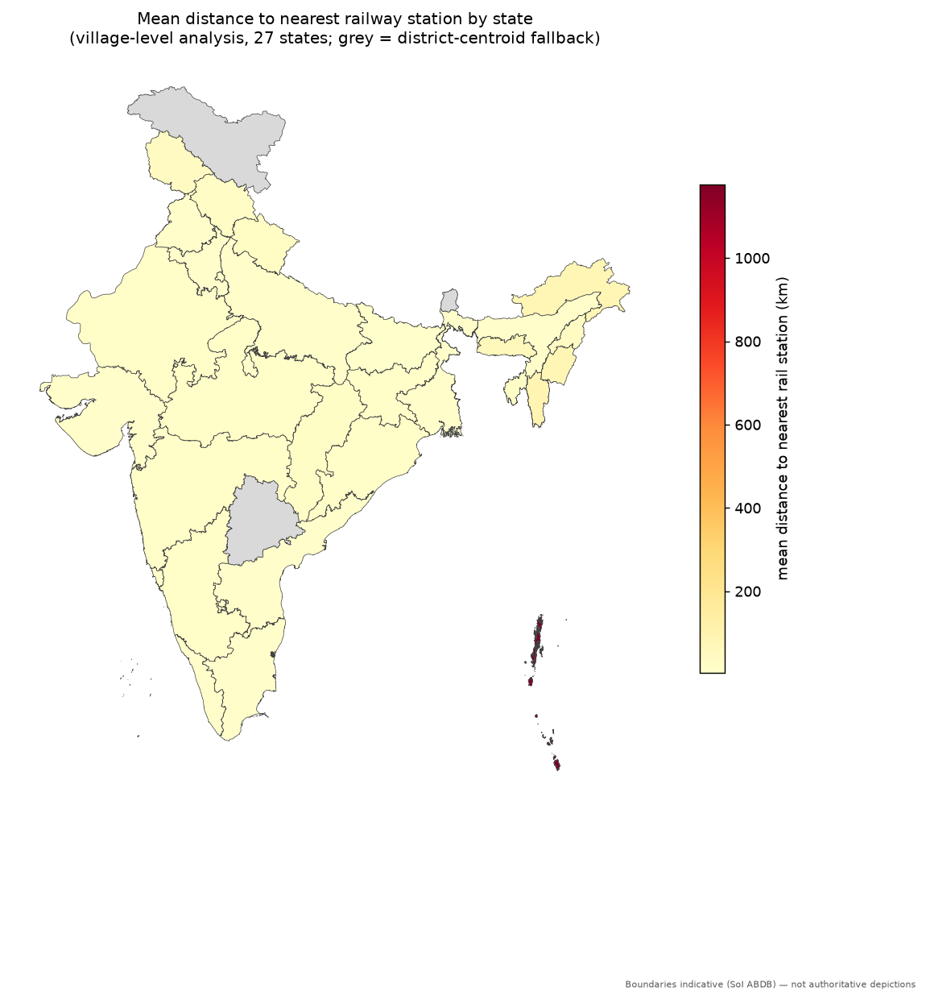

# 🇮🇳 GISIndia4Logistics

> **Review checkpoint, not a release:** canonical interfaces and producer safeguards are under review on `quality/decision-workbench-stabilization`. Stage 4 national outputs have **not** been regenerated; N1d acceptance, route-matched tolls and the corridor/export journey remain pending. See the [current status and next steps](docs/stabilization_plan.md#current-checkpoint).

[](https://github.com/subhams07/gisindia4logistics/releases)
[](pyproject.toml)
[](LICENSE)
[](docs/audit_report.md)
[](DATA_LICENSE.md)
[](docs/USER_MANUAL.md)

> **The Open-Source Geospatial & Multimodal Freight Analytics Platform for India.**
> Strategic supply-chain scenarios and village-level infrastructure accessibility, with explicit data and model limitations.

---

## 🌟 Why GISIndia4Logistics?

Analyzing supply chain, infrastructure connectivity, and logistics costs in India has historically meant wrestling with fragmented shapefiles, unstandardized district names, mismatched Census boundaries, and expensive proprietary routing engines.

**GISIndia4Logistics** is a strategic analytics platform under development, combining a spatial data warehouse and analytical models:
- **781 Current LGD Districts & 578,000+ Villages/Settlements** across all 36 States/UTs.
- **Topological National Highway Network** (141,990 segments in EPSG:7755) with speed-weighted Dijkstra routing and modelled distance-based toll estimates, not FASTag/NHAI tariffs.
- **Dedicated Freight Corridors (DFC) & Railway Infrastructure** (8,697 stations, 5,938 NSG categories, 84 Gati Shakti Cargo Terminals).
- **250+ Logistics Hubs** (Major Ports, ICDs/CFSs, MMLPs, Land Border ICPs, Air Cargo, FCI Silos, Cold Chains, Agri Mandis).
- **Intermodal Cost Optimization & Gravity Port Catchment Models** out-of-the-box.
- **Multi-Surface Access**: Python SDK, Command-Line Tool, FastAPI REST Server, and Model Context Protocol (MCP) tool server for AI agents.

---

## 💡 What Questions Can This Platform Answer?

| Domain | Practical Question | Platform Capability |
|---|---|---|
| 🛣️ **Highway Transit & Toll Costing** | *"What modelled highway distance, free-flow duration and toll estimate does a MAV 20T scenario produce between Pune and Chennai?"* | **Strategic Highway Router**: Computes speed-weighted network paths and modelled distance-based toll estimates. OSM toll locations are not an official register; estimates are not verified FASTag/NHAI tariffs or operational travel-time guarantees. |
| 🚂 **Multimodal Freight Optimization** | *"For a 24-tonne container shipment from Indore to JNPT, is rail or DFC cheaper than road trucking? What is the breakeven distance?"* | **Intermodal Cost Optimizer**: Compares linehaul rates, first/last mile cartage, terminal handling, and inventory transit costs to find optimal modal shift and INR savings. |
| 🚢 **Port Hinterlands & Contestability** | *"If Jawaharlal Nehru Port (JNPT) improves turnaround times, how many central Indian districts shift cargo share from Mundra or Kandla?"* | **Huff Gravity Catchment Model**: Models national port hinterland contestability and population capture across all 12 Major Commercial Ports. |
| 🏭 **Site Selection & Facility Siting** | *"Where should a retail giant or 3PL position an express fulfillment center to reach 75% of regional consumer demand within a 4-hour drive?"* | **Isochrone & Accessibility Engine**: Generates 1h, 2h, 4h, and 8h vector drive-time catchments and nearest-infrastructure matrices. |
| 🌾 **Rural Reach & Agri-Supply Chain** | *"What percentage of agricultural villages in Haryana or Uttar Pradesh are within 10 km of a rail siding or 50 km of an ICD?"* | **Dual-Distance Village Access Engine**: Geodesic spatial overlay across 578,000+ village polygons and settlements in all 36 States/UTs. |
| 📊 **District Logistics Scorecards** | *"How do infrastructure connectivity, highway proximity, and demographic indicators rank across every district in India?"* | **Automated District Scorecards**: Instant 360° logistical profiles for all 781 districts with 2024-25 LGD coding and conserved Census populations. |

---

## 👥 Who Is This Relevant For?

- 🚚 **Logistics Providers, 3PLs & Fleet Operators**: Explore strategic corridor and multimodal scenarios; independently verify routes, tariffs and transit times before operational use.
- 💼 **Strategy & Infrastructure Consultants (McKinsey, BCG, Big 4)**: Explore baseline inputs for infrastructure and supply-chain studies, subject to independent source, model and legal review.
- 🏢 **Industrial Real Estate & Warehouse Developers**: Screen land parcels, benchmark highway access, and generate drive-time isochrones for prospective tenant pitches.
- 🔬 **Geospatial Data Scientists & Academic Researchers**: Curated geospatial datasets (EPSG:7755 LCC + EPSG:4326) with standardized join keys and recorded validation evidence. Source terms and redistribution rights vary; unresolved conditions are documented in [DATA_LICENSE.md](DATA_LICENSE.md) and [sources](docs/sources.md).
- 🤖 **AI Agents & LLM Engineers**: Equip Claude, ChatGPT, Cursor, and Antigravity agents with spatial intelligence via the built-in **Model Context Protocol (MCP)** tool server.
- 🏛️ **Policymakers & Public Sector Agencies**: Identify infrastructure cold-spots, audit rural connectivity, and model the economic impact of new freight corridor investments.

---

## 🚀 Quickstart: Choose Your Interface

### 1. Python SDK (source checkout)

```bash
git clone https://github.com/subhams07/gisindia4logistics.git
cd gisindia4logistics
pip install -r requirements.txt
pip install -e .
```

Use an activated Python environment as described in the [manual](docs/USER_MANUAL.md). This does not assert a published PyPI release or verified cold-install/Docker deployment.

```python
import gisindia4logistics as gis

# 1. Get complete district logistics scorecard & demographics
pune = gis.get_district("Pune")
print(f"Nearest Highway: {pune.get('nearest_highway_km')} km | Nearest Port: {(pune.get('nearest_port') or {}).get('name')}")

# 2. Strategic highway routing & modelled toll estimate (not official tariffs)
route = gis.route_highway(origin=(18.5204, 73.8567), destination=(18.9500, 72.9500), vehicle_type="MAV_20T")
print(f"Distance: {route['distance_km']} km | Drive Time: {route['drive_time_formatted']} | Toll: INR {route['estimated_toll_cost_inr']}")

# Rich canonical result: strict location references, quality, provenance and optional geometry
plan = gis.plan_highway_route(
    origin={"type": "district", "district_code": 521},
    destination={"type": "hub", "hub_type": "port", "name": "JNPT"},
    vehicle_type="LCV", geometry_detail="simplified",
)
print(plan["route_quality"]["warnings"])

# 3. Intermodal Freight Cost Optimization (Road vs Rail vs DFC)
freight = gis.calculate_freight_cost(origin_district="Indore", payload_tons=24.0, road_linehaul_rate=3.80)
print(f"Optimal Mode: {freight['optimal_mode']} | Savings: {freight['modal_shift_savings_pct']:.1f}% (INR {freight['modal_shift_savings_total_inr']:,.0f})")

# 4. Find Nearest Logistics Facilities (Geodesic KDTree)
nearest = gis.find_nearest(latitude=28.6139, longitude=77.2090, top_k=3)
# Returns a dictionary keyed by facility category; no facility_types filter.
print(nearest["ports"])

# 5. Simulate Port Hinterland Catchment
ports = gis.simulate_port_catchment(alpha=0.85, beta=1.65)
print(f"Top Port: {ports[0]['port_name']} captures {ports[0]['captured_districts_count']} districts")
```

---

### 2. Command-Line Interface (CLI)

```bash
# Calculate highway route, travel hours, and toll estimate
gisindia4logistics route --origin 18.5204,73.8567 --dest 18.9500,72.9500 --vehicle MAV_20T

# Rich JSON result (Bash syntax); geometry defaults to none
gisindia4logistics route-plan --origin '{"type":"district","district_code":521}' --dest '{"type":"hub","hub_type":"port","name":"JNPT"}' --vehicle LCV --geometry simplified

# Simulate intermodal freight cost for a district
gisindia4logistics cost --origin Indore --payload 24.0 --road-rate 3.80

# Launch the FastAPI REST Server
gisindia4logistics serve --port 8000

# Launch the stdio Model Context Protocol (MCP) server
gisindia4logistics mcp
```

---

### 3. High-Performance FastAPI REST Server & Docker

Run locally for evaluation; operational deployment requires independent validation:

```bash
# Run with Docker Compose
docker-compose up --build -d

# Or run directly with Uvicorn
uvicorn server.app:app --host 0.0.0.0 --port 8000
```
- **Interactive Swagger UI**: Explore and test all endpoints interactively at `http://localhost:8000/docs`.
- **OpenAPI 3.1 Spec**: Ready for client generation in TypeScript, Go, Java, or Python.

`POST /api/v1/route/highway/plan` accepts the rich SDK example's location objects, `vehicle_type`, `geometry_detail` and `include_route_geometry`. The legacy `/api/v1/route/highway` coordinate-pair endpoint remains. Rich defaults are `MAV_20T`, `include_route_geometry=true`, `geometry_detail="none"`; either suppression control removes display geometry. Rich results contain no toll calculation. Route quality and limitations must accompany distance/time interpretations.

Compatibility notes: canonical routing now applies vehicle speed factors and compatible-component snapping; legacy route numbers may change, and zero movement yields zero tolls. Strict numeric/boolean validation rejects numeric strings and booleans used as coordinates/codes. SDK bridges raise domain exceptions rather than FastAPI exceptions. REST validation errors use a safe structured `detail` contract, MCP errors contain safe JSON with `isError=true`, and CLI client errors exit 2 versus service failures exit 1. This is not a navigation or deployment readiness claim.

---

### 4. AI Agent Integration (Model Context Protocol / MCP)

Equip AI assistants (Claude Desktop, Cursor, Antigravity) with spatial intelligence. Add this to your `mcp_config.json`:

```json
{
  "mcpServers": {
    "gisindia4logistics": {
      "command": "python",
      "args": ["-m", "mcp_server.server"]
    }
  }
}
```
**Built-In AI Tools:**
- `gis_get_district_scorecard`: Instant logistics & demographic profile for any Indian district.
- `gis_highway_route_and_tolls`: Strategic highway transit times and modelled distance-based toll estimates, not verified FASTag/NHAI tariffs.
- `gis_plan_highway_route`: Rich canonical routing with discriminated location references, optional geometry, quality and provenance; no matched tolls or official tariff claims.
- `gis_calculate_intermodal_freight_cost`: Multimodal freight comparison (Road, Rail, DFC) with custom rate overrides.
- `gis_find_nearest_facilities`: Nearest ports, ICDs, MMLPs, toll plazas, and stations to any coordinates.
- `gis_simulate_port_catchment`: Gravity-based port contestability modeling.
- `gis_plot_villages_map`: Generates interactive Leaflet HTML or 300 DPI PNG accessibility choropleths.

---

### 5. Direct Desktop GIS Loading (QGIS / ArcGIS / Kepler.gl)

Load committed datasets directly from the `data/` folder without network dependencies:

```python
import geopandas as gpd

# Load 781 Current LGD Districts
districts = gpd.read_file("data/administrative/india_districts_lgd.geojson")

# Load National Highway Network (141k segments)
nh_network = gpd.read_file("data/roads/india_nh_network.geojson")

# Load Dedicated Freight Corridors (WDFC & EDFC)
dfc_lines = gpd.read_file("data/rail/dfc_network.geojson")

# Load Logistics Infrastructure Hubs
import pandas as pd
ports = pd.read_csv("data/logistics_hubs/ports.csv")
icds  = pd.read_csv("data/logistics_hubs/icds.csv")
mmlps = pd.read_csv("data/logistics_hubs/mmlps.csv")
# CSV latitude/longitude columns are not automatically GIS point geometry.
```

---

## 📦 Curated Geospatial Data Catalog

Spatial layers use **`EPSG:4326` (WGS 84)** / **`EPSG:7755` (India NSF LCC)**; administrative joins use **Local Government Directory (LGD)** codes where available. License labels below are an inventory, not permission: [DATA_LICENSE.md](DATA_LICENSE.md) records mixed terms and unresolved redistribution conditions. Survey of India copyright is not a blanket GODL-India grant; public access to official rosters does not establish reuse rights.

| Layer | What's Included | Feature Count | Source / Lineage | License / Conditions |
|---|---|---|---|---|
| 🏛️ **States (Current)** | LGD-coded administrative boundaries | **36 States/UTs** | Survey of India (ABDB) | SoI copyright; redistribution unresolved |
| 🏛️ **Districts (Current)** | Complete 2024–25 administrative polygons | **781 Districts** | Survey of India (ABDB) | SoI copyright; redistribution unresolved |
| 🏛️ **Sub-Districts (Talukas)** | Sub-district administrative polygons | **6,636 Sub-districts** | Survey of India (ABDB) | SoI copyright; redistribution unresolved |
| 🏡 **Villages & Habitations** | Coverage across all 36 States/UTs (polygons + habitations) | **578,345 Settlements** | Survey of India / OpenStreetMap | Mixed SoI copyright (redistribution unresolved) + ODbL |
| 🛣️ **National Highways** | Topological road network by class (Motorway/Trunk/Primary) | **141,990 Segments (~634 Routes)** | OpenStreetMap geometry; MoRTH is a separate reference source | ODbL |
| 🏷️ **Toll Plazas** | Clustered OSM toll booths; not an official NHAI register or verified tariff source | **1,536 Plazas** | OpenStreetMap Overpass, 150m DBSCAN | ODbL |
| 🚂 **Rail Infrastructure** | 2016 station base with later zone/division enrichment and a separate category roster; current operational status not verified | **8,697 Stations; 5,938 category records, 5,493 joined station codes** | DataMeet railways (Indian Railways/erail lineage); community classification enrichment | Unclear station license; reference data, redistribution unresolved |
| ⚡ **Dedicated Freight Corridors** | Operational WDFC & EDFC routes + 54 DFC junctions | **2,843 km Alignment** | DFCCIL | GODL-India |
| 🏗️ **Freight Terminals** | Gati Shakti Cargo Terminals (GCT) with geocodes | **84 Terminals** | Ministry of Railways / PIB | GODL-India |
| 🚢 **Ports & Maritime** | Major Commercial Ports and Non-Major Cargo Ports | **22 Ports** | IPA / public-source compilation | Mixed official references / Wikipedia rows; per-row terms unresolved |
| 📦 **Inland Container Depots** | Dry ports, ICDs, and Container Freight Stations (CFS) | **44 ICDs/CFSs** | CBIC / CONCOR / public-source compilation | Mixed official references / Wikipedia rows; per-row terms unresolved |
| 🏬 **Multimodal Logistics Parks** | Awarded & planned MMLP hub locations | **20 MMLPs** | NHLML / PIB / Wikipedia fallback | Mixed official references / Wikipedia rows; per-row terms unresolved |
| ✈️ **Air Cargo Terminals** | International and domestic air cargo airports | **25 Airports** | AAI / operators / Wikipedia compilation | Mixed official references / Wikipedia rows; per-row terms unresolved |
| 🛂 **Land Border ICPs** | Land Customs Stations & Integrated Check Posts | **19 ICPs** | LPAI / public-source compilation | Mixed official references / Wikipedia rows; per-row terms unresolved |
| 🌾 **Grain Storage & Agri Mandis** | FCI food grain storage depots & APMC e-NAM Mandis | **77 FCI Silos + 16 e-NAM Mandis** | FCI / e-NAM Portal | GODL-India |
| ❄️ **Cold Chain Infrastructure** | Multi-commodity cold storage facilities | **15 Key Hubs** | NCCD / MoFPI | GODL-India |
| 🏭 **Industrial Clusters** | NICDC Industrial Nodes & PM MITRA Textile Mega Parks | **21 NICDC Nodes + 7 PM MITRA** | DPIIT / Ministry of Textiles | GODL-India |
| 👥 **Demographics & Population** | Conserved 2011 Census + 781-District Spatial Allocation | **1.21 Billion Pop. Conserved** | ORGI / Registrar General | GODL-India |

The machine-readable catalog specification is published at [`catalog.yaml`](catalog.yaml).

---

## 🗺️ Interactive Visualizations & Mapping

Generate interactive Leaflet HTML maps with mouseover tooltips or 300 DPI publication choropleths:

```bash
# Generate interactive HTML map and high-resolution PNG choropleth for a district
python scripts/analyze/plot_villages.py --state Haryana --district Ambala --metric dist_rail_station_km --format both
```
View directly in your browser: `http://localhost:8000/api/v1/admin/villages/map.html?state=Haryana&district=Ambala`



---

## 🛡️ Rigorous Quality Assurance & Legal Compliance

### 279-Check Automated National Data Audit
The recorded full audit reports **279 checks: 268 PASS / 11 WARN / 0 FAIL** (`scripts/audit/audit_all.py`). Warnings remain unresolved; passing checks are not proof of operational routing accuracy, freshness or legal clearance. Recorded checks include:
- ✅ **Boundary Topology**: Exact 36 States, 781 Districts, 0 zero-area polygons, 100% valid geometries on disk re-read.
- ✅ **Population Conservation**: 1,210,846,210 population conserved across 781 current districts (<0.001% delta from Census 2011).
- ✅ **Highway Routing Physics**: Implied network speeds strictly bounded between $25\text{ and }110\text{ km/h}$ (median $69.4\text{ km/h}$). Zero unrouted mainland districts. Island UTs strictly null-routed for land freight.
- ✅ **Pickle-Free Security**: Cache loading enforced with `allow_pickle=False` and full 64-character SHA-256 geometry/attribute fingerprinting.

Read the committed audit snapshot at [`docs/audit_report.md`](docs/audit_report.md); it is not a live verification of this working tree.

### 2021 DST Geospatial Guidelines Compliance
The **Liberalized Geospatial Data Guidelines (2021)** issued by the Department of Science & Technology (DST), Government of India are a policy reference, not unconditional legal clearance:
- The intended scope is civilian strategic logistics analytics; source-specific terms still apply.
- Public accessibility and geometry precision alone do not establish redistribution permission. Review [DATA_LICENSE.md](DATA_LICENSE.md); Survey of India and DataMeet station licensing remain unresolved.
- Standard disclaimer: All boundaries are indicative representations published for logistics analytics, not authoritative Survey of India boundary certifications. See [`docs/legal_compliance.md`](docs/legal_compliance.md).

---

## 📖 Documentation & Guides

Existing public SDK/CLI/REST/MCP entrypoints are described above, but parity and operational accuracy remain under stabilization. Phase 1 schemas and JSON examples in `docs/contracts/` describe future workbench contracts, not evidence that corridor planning, district comparison, matched official toll tariffs or PDF/XLSX exports are publicly implemented or accepted. See [stabilization plan](docs/stabilization_plan.md); no stage is accepted.

- 📘 **[User Manual & Developer Guide](docs/USER_MANUAL.md)** — In-depth tutorials, Python cookbook, API specs, and QGIS workflows.
- 📐 **[Model Assumptions & Analytical Formulas](docs/model_assumptions.md)** — Speed calculations, toll formulas, and freight cost models.
- 📚 **[Data Sources & Provenance](docs/sources.md)** — Upstream source URLs, recorded vintages and unresolved lineage conditions.
- 📜 **[Data Licensing Details](DATA_LICENSE.md)** — Source-class terms and unresolved redistribution conditions; MIT covers code only.

---

## 🤝 Contributing & Community

Contributions of new logistics datasets, improved routing algorithms, and documentation improvements are warmly welcomed!
Please read our [Contributing Guide](CONTRIBUTING.md), [Security Policy](SECURITY.md), and [Code of Conduct](CODE_OF_CONDUCT.md) before submitting pull requests.

---

<div align="center">
  <sub>Built with ❤️ for Indian logistics, infrastructure planners, and supply chain innovators.</sub>
</div>
