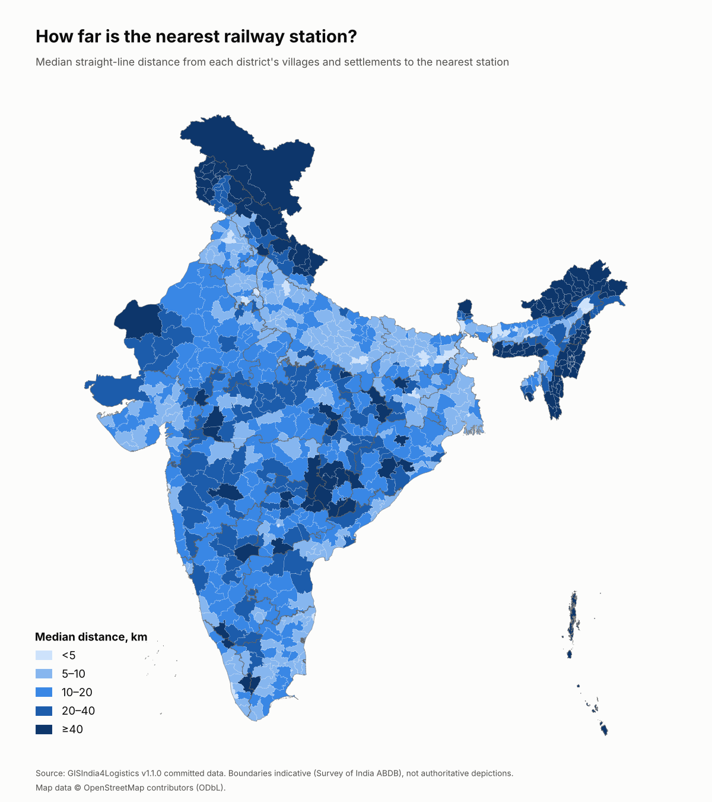
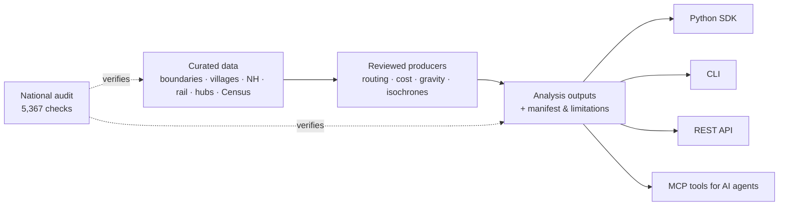
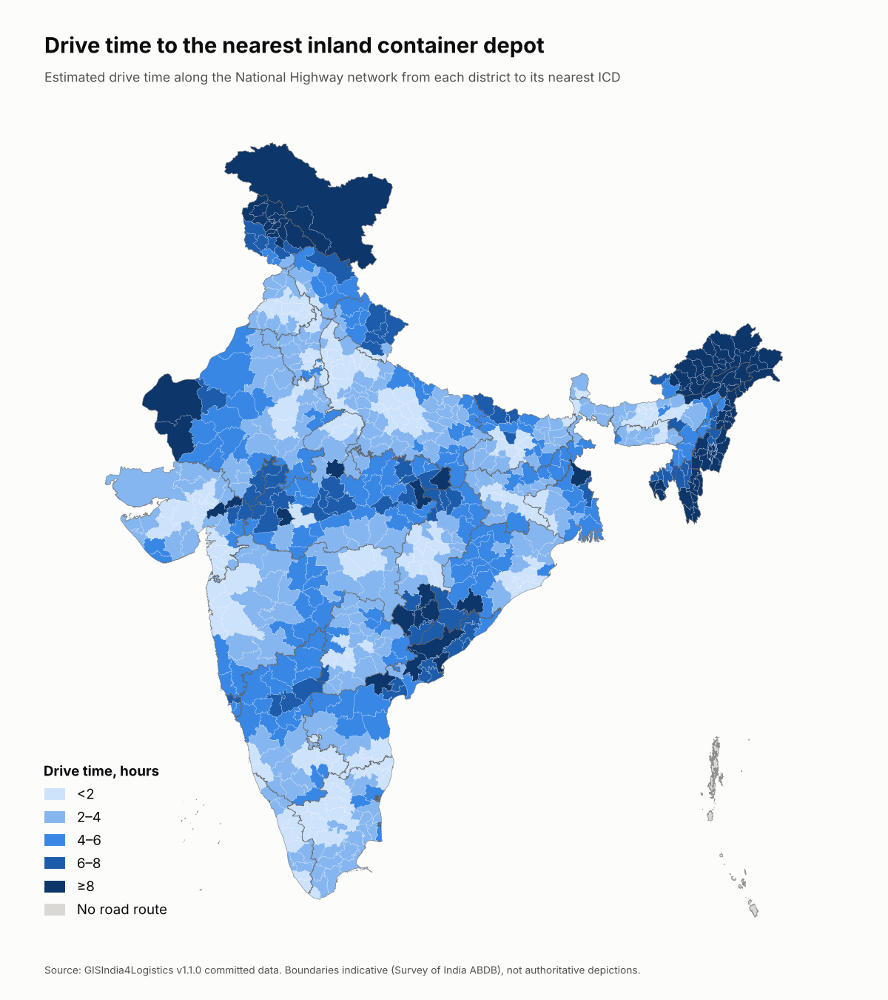

# 🇮🇳 GISIndia4Logistics

[](CHANGELOG.md)
[](#about-this-project)
[](pyproject.toml)
[](LICENSE)
[](docs/audit_report.md)
[](DATA_LICENSE.md)

> **India's logistics map, ready to analyse.**
> Every district, more than 600,000 villages and settlements, the National Highway network, rail, ports and about 300 logistics hubs and industrial sites, joined on official LGD codes. It comes with routing, freight-cost and port-catchment models you can use from Python, the command line, a REST API or an AI agent.

> [!NOTE]
> **This is a personal hobby project**, built and maintained in spare time and shared as-is. There is no support commitment, and pull requests and outside contributions are not being accepted. You're welcome to use and fork it under the licences below.

<p align="center">
  <picture>
    <source media="(prefers-color-scheme: dark)" srcset="docs/img/readme_rail_access_dark.png">
    
  </picture>
</p>

---

## 🌟 Why GISIndia4Logistics?

Logistics analysis in India usually starts with weeks of data plumbing: fragmented shapefiles, district names that never match, Census boundaries from 2011, and hub lists scattered across ministry PDFs. This project does that plumbing once, in the open, and publishes the evidence alongside the data.

- **One join key for everything.** States, districts, sub-districts and villages carry [Local Government Directory (LGD)](https://lgdirectory.gov.in) codes, so every layer joins cleanly. Coordinates are in EPSG:4326, and metric work uses EPSG:7755.
- **National coverage.** 780 current districts and 621,105 villages and settlements in all 36 States/UTs, each with a precomputed accessibility profile. In the 9 border/NE States/UTs where Survey of India publishes no village polygons, OSM settlement points stand in, and their coverage is partial.
- **Models, not just maps.** Highway routing and drive times, road vs rail vs DFC freight cost, port hinterland gravity, and drive-time isochrones.
- **Reproducible and audited.** Analysis outputs are produced by committed scripts, and the core routing, cost, gravity and isochrone outputs carry a manifest of input and code hashes. v1.1.0 passes a 5,367-check national audit with 0 failures.
- **Honest about its limits.** Known limitations and licensing conditions are published, not buried; see [Known limitations](#known-limitations).

---

## 📊 India at a Glance

Headline figures computed from the committed v1.1.0 outputs:

| Indicator | Value |
|---|---|
| Median distance from a village or settlement to the nearest National Highway | **6.6 km** (65.8% within 10 km) |
| Median distance from a village or settlement to the nearest railway station | **13.3 km** (39.9% within 10 km) |
| Median district drive time to the nearest Gati Shakti cargo terminal | **3.1 h** |
| Median district drive time to the nearest ICD / CFS | **3.7 h** |
| Median district drive time to the nearest major port | **12.2 h** |
| Districts captive to a single major port (gravity model) | **29 of 780** (688 are contested between ports) |

Village figures are straight-line distances over all 621,105 settlements. Drive times run over the National Highway network for the 777 mainland districts. The gravity model uses uncalibrated parameters (α = 0.85, β = 1.65).

---

## 💡 What Questions Can It Answer?

| Domain | Example question | Capability |
|---|---|---|
| 🛣️ **Highway transit** | *"What is the highway distance and free-flow drive time from Pune to JNPT for a 20-tonne truck?"* | **Strategic highway router.** Speed-weighted, component-aware shortest paths on 141,990 NH segments, with route-quality warnings. Tolls are modelled estimates, not FASTag/NHAI tariffs. |
| 🚂 **Modal choice** | *"For 24 tonnes from Ludhiana, is rail or DFC cheaper than road, and by how much?"* | **Intermodal cost engine.** Linehaul, first/last-mile, terminal handling and inventory cost for road, conventional rail and (for origins near the corridors) DFC, with your own rate overrides. |
| 🚢 **Port hinterlands** | *"Which districts are captive to Paradip, and which are contested between ports?"* | **Huff gravity model.** Market-share probabilities and contestability for the 777 mainland districts (4 island districts flagged) across the 12 major ports, with α/β you can tune. |
| 🏭 **Site screening** | *"How far does an 8-hour drive reach from JNPT or the Nagpur MMLP?"* | **Isochrones.** Drive-time catchments at 4, 8, 12 and 24 h around 12 major ports and at 4, 8 and 12 h around 20 MMLPs. |
| 🌾 **Rural reach** | *"What share of villages in a district are within 10 km of a railway station?"* | **Village access engine.** Nearest NH, expressway, station, terminal, port, ICD, ICP, air cargo, MMLP, waterway terminal, FCI depot and toll plaza for every settlement. |
| 📋 **District scorecards** | *"How does Pune compare on highway, rail and port access?"* | **District profiles.** Access, drive times, nearest hubs and population for all 780 LGD districts. |

---

## 👥 Who Might Find It Useful

- 🚚 **Logistics and supply-chain people** sketching corridor or modal scenarios.
- 🏢 **Site and warehouse analysts** comparing highway, rail and port access across locations.
- 🏛️ **Policy and infrastructure watchers** looking for connectivity gaps between districts.
- 🔬 **Researchers, students and data scientists** who want clean, LGD-joined Indian layers.
- 🤖 **AI tinkerers** giving Claude, Cursor or another MCP client India-specific spatial tools.

Outputs are strategic estimates from a hobby project. Verify routes, tariffs and transit times independently before any operational or commercial decision.

---

## 🧭 How It Fits Together



---

## 🚀 Quickstart

### 1. Install (from source)

```bash
git clone https://github.com/subhams07/gisindia4logistics.git
cd gisindia4logistics
python -m venv .venv && source .venv/bin/activate   # Windows: .venv\Scripts\activate
pip install -e .
```

The data ships with the repository, so no downloads or API keys are needed; a full checkout is about 1.3 GB. The project is installed from source only (it is not published on PyPI) and is tested on Python 3.11.

### 2. Python SDK

```python
import gisindia4logistics as gis

# District scorecard
pune = gis.get_district("Pune")
print(pune["nearest_highway_km"], pune["nearest_port"]["name"])

# Strategic highway route with a modelled toll estimate (not an official tariff)
route = gis.route_highway(origin=(18.5204, 73.8567), destination=(18.9500, 72.9500), vehicle_type="MAV_20T")
print(route["distance_km"], route["drive_time_formatted"], route["estimated_toll_cost_inr"])

# Rich route: strict location references, quality warnings, provenance, optional geometry
plan = gis.plan_highway_route(
    origin={"type": "district", "district_code": 521},
    destination={"type": "hub", "hub_type": "port", "name": "JNPT"},
    vehicle_type="LCV", geometry_detail="simplified",
)
print(plan["route_quality"]["warnings"])

# Road vs rail vs DFC (DFC applies to origins near the corridors, e.g. Ludhiana)
freight = gis.calculate_freight_cost(origin_district="Ludhiana", payload_tons=24.0, road_linehaul_rate=3.80)
print(freight["optimal_mode"], f"{freight['modal_shift_savings_pct']:.1f}% saving")

# Nearest facilities by category (straight-line, geodesic)
nearest = gis.find_nearest(latitude=28.6139, longitude=77.2090, top_k=3)
print(nearest["icds"][0]["name"])

# Port catchment simulation with tunable gravity parameters
ports = gis.simulate_port_catchment(alpha=0.85, beta=1.65)
print(ports[0]["port_name"], ports[0]["captured_districts_count"])
```

### 3. Command line

```bash
gisindia4logistics route --origin 18.5204,73.8567 --dest 18.9500,72.9500 --vehicle MAV_20T
gisindia4logistics route-plan --origin '{"type":"district","district_code":521}' --dest '{"type":"hub","hub_type":"port","name":"JNPT"}' --vehicle LCV --geometry simplified
gisindia4logistics cost --origin Ludhiana --payload 24.0 --road-rate 3.80
gisindia4logistics district Pune
gisindia4logistics serve --port 8000     # REST API
gisindia4logistics mcp                   # MCP server (stdio)
```

### 4. REST API

```bash
gisindia4logistics serve --port 8000
# or: uvicorn server.app:app --host 0.0.0.0 --port 8000
# or (evaluation, not verified for deployment): docker-compose up --build -d
```

Interactive docs are served at `http://localhost:8000/docs` (OpenAPI 3.1). Endpoints cover district scorecards, highway routes (`/api/v1/route/highway` and the richer `/api/v1/route/highway/plan`), precomputed port and MMLP isochrones, freight-cost and port-gravity simulation, and village maps. Validation errors return a structured `detail`; see the [User Manual](docs/USER_MANUAL.md) for the contract. The server is for evaluation; validate it independently before operational deployment.

### 5. AI agents (Model Context Protocol)

```json
{
  "mcpServers": {
    "gisindia4logistics": { "command": "/path/to/gisindia4logistics/.venv/bin/python", "args": ["-m", "mcp_server.server"] }
  }
}
```

| Tool | What it does |
|---|---|
| `gis_get_district_scorecard` | Logistics and demographic profile for any district |
| `gis_plan_highway_route` | Canonical route with quality warnings and provenance |
| `gis_highway_route_and_tolls` | Route plus modelled toll estimate |
| `gis_calculate_intermodal_freight_cost` | Road vs rail vs DFC comparison |
| `gis_find_nearest_facilities` | Nearest ports, ICDs, MMLPs, other hubs and toll plazas to a point |
| `gis_simulate_port_catchment` | Gravity-based port contestability |
| `gis_plot_villages_map` | Leaflet HTML or 300 DPI PNG accessibility map |

### 6. QGIS, ArcGIS, Kepler.gl or GeoPandas

```python
import geopandas as gpd, pandas as pd
districts = gpd.read_file("data/administrative/india_districts_lgd.geojson")   # 780 districts
nh = gpd.read_parquet("data/roads/india_nh_network.parquet")                    # 141,990 segments
dfc = gpd.read_file("data/rail/dfc_network.geojson")                            # WDFC, EDFC, link
ports = pd.read_csv("data/logistics_hubs/ports.csv")                            # lat/lon columns
```

---

## 📦 Data Catalog

Spatial layers use **EPSG:4326**, and metric analysis uses **EPSG:7755**. Administrative joins use **LGD codes**. The machine-readable inventory, with source, licence, vintage and quality status for every dataset, is [`catalog.yaml`](catalog.yaml).

The licence column is an inventory, not a grant. [DATA_LICENSE.md](DATA_LICENSE.md) records mixed terms and unresolved redistribution conditions; MIT covers the code only.

| Layer | Contents | Count | Source | Licence / conditions |
|---|---|---|---|---|
| 🏛️ **States** | LGD-coded boundaries | **36** | Survey of India ABDB | SoI copyright; redistribution unresolved |
| 🏛️ **Districts** | 2024–25 administrative polygons | **780** | Survey of India ABDB | SoI copyright; redistribution unresolved |
| 🏛️ **Sub-districts** | Taluka/tehsil polygons | **6,636** | Survey of India ABDB | SoI copyright; redistribution unresolved |
| 🏡 **Villages** | LGD-coded village polygons | **586,151** in 27 States/UTs | Survey of India | SoI copyright; redistribution unresolved |
| 🏡 **Habitations** | Settlement points where SoI publishes no polygons | **34,954** in 9 border/NE States/UTs | OpenStreetMap | ODbL |
| 🛣️ **National Highways** | Topological network (motorway/trunk/primary) | **141,990 segments** | OpenStreetMap | ODbL |
| 🏷️ **Toll plazas** | Clustered OSM toll points; not an NHAI register | **1,536** | OpenStreetMap | ODbL |
| 🚂 **Railway stations** | 2016 base with zone/division enrichment | **8,697** (5,938 category records) | DataMeet + community classification | Unclear; redistribution unresolved |
| ⚡ **Dedicated Freight Corridors** | WDFC, EDFC and the Dadri–Khurja link | **3 alignments, 54 stations** | DFCCIL | GODL-India |
| 🏗️ **Gati Shakti cargo terminals** | 2023 identified GCT roster, not all commissioned (78 geocoded, 6 pending) | **84** | Ministry of Railways / PIB | GODL-India |
| 🚢 **Ports** | Major and non-major cargo ports | **22** | IPA / public sources | Mixed; per-row terms |
| 📦 **ICDs / CFSs** | Dry ports and freight stations | **44** | CBIC / CONCOR / public sources | Mixed; per-row terms |
| 🏬 **MMLPs** | Awarded and planned multimodal logistics parks | **20** | NHLML / PIB | Mixed; per-row terms |
| ✈️ **Air cargo** | Cargo-handling airports | **25** | AAI / operators | Mixed; per-row terms |
| 🛂 **Land border ICPs** | Integrated check posts | **19** | LPAI | Mixed; per-row terms |
| ⛴️ **Inland waterway terminals** | NW-1/2/3/4/5/16 terminals | **40** | IWAI | GODL-India |
| 🌾 **Agri and storage** | FCI depots, e-NAM mandis, cold-chain hubs | **77 + 16 + 15** | FCI / e-NAM / NCCD | GODL-India |
| 🏭 **Industrial clusters** | NICDC nodes and PM MITRA parks | **21 + 7** | DPIIT / Ministry of Textiles | GODL-India |
| 👥 **Population** | Census 2011, allocated to 780 current districts | **1.21 billion conserved** | ORGI | GODL-India |
| 📈 **Freight series** | Rail freight, port throughput, road network, FY20–FY24 | **137 annual records** | PIB / IPA / MoRTH | GODL-India |

**Analysis outputs** (in `data/analysis/`):
- Regenerated for v1.1.0, with a provenance manifest:
  - the district travel-time summary and the district × port drive-time matrix;
  - freight modal split and port hinterland catchment;
  - port and MMLP isochrones.
- From 2026-08, with no manifest: village access for all 621,105 settlements (straight-line), with sub-district, district and national summaries.

---

## 🗺️ Maps

<p align="center">
  <picture>
    <source media="(prefers-color-scheme: dark)" srcset="docs/img/readme_icd_drive_dark.png">
    
  </picture>
</p>

The two maps on this page come from `scripts/analyze/make_readme_figures.py`. You can draw village-level maps for any district too:

```bash
python scripts/analyze/plot_villages.py --state Haryana --district Ambala --metric dist_rail_station_km --format both
```

With the API running, maps are also available at `http://localhost:8000/api/v1/admin/villages/map.html?state=Haryana&district=Ambala`.


---

## 🛡️ Quality You Can Check

**v1.1.0 evidence.** The national audit (`scripts/audit/audit_all.py --national`) ran 5,367 checks: 5,351 PASS, 16 WARN, 0 FAIL. The test suite passed 3,508 tests with 0 failures. Report: [`docs/audit_report.md`](docs/audit_report.md).

**What the audit checks:**
- ✅ **Boundaries.** 36 states and 780 districts, valid geometries on re-read, and LGD joins across layers.
- ✅ **Population.** 1,210,846,213 people conserved across the 780 current districts, within 0.001% of Census 2011.
- ✅ **Provenance.** The seven core analysis outputs are hash-matched to the inputs and code recorded in `producer_manifest.json`.
- ✅ **Independent recomputation.** Graph, route, isochrone and coverage oracles, and freight and hinterland results, are recomputed and compared.

**The 16 warnings:**
- 15 are disclosed source issues: blank village names in SoI files (in 9 states), village counts above the Census-2011 reference for Delhi and Chandigarh, and duplicate LGD codes.
- 1 is an informational audit note.

Passing checks are not proof of operational routing accuracy, data freshness or legal clearance.

**Geospatial guidelines.** The project follows the DST Geospatial Guidelines (2021) as a policy reference for civilian logistics analytics. All boundaries are indicative, not authoritative Survey of India certifications. See [`docs/legal_compliance.md`](docs/legal_compliance.md).

---

## Known Limitations

These limitations are disclosed with v1.1.0; details are in the [CHANGELOG](CHANGELOG.md) and `data/analysis/producer_limitations.json`.

- **Gravity model.** The parameters (α 0.85, β 1.65) are **uncalibrated**; a sensitivity table is in [the drift report](docs/stage4_drift_linux-2026-10-18-run1.md).
- **Routing scope.** Routing uses the OSM National Highway network only (no state roads), at free-flow speeds. 372 district–hub pairs have road distances more than 3× the straight-line distance.
- **Island values.** Highway-access values for Lakshadweep and the Nicobars are over-sea distances.
- **Isochrone snapping.** Hubs snap to the nearest highway component of at least 1,000 nodes within 150 km. This is a modelling policy.
- **Tolls.** Toll figures are distance-based estimates, not FASTag/NHAI tariffs.
- **API warnings.** API responses do not yet carry these routing limitations at the point of use; read `producer_limitations.json`.
- **Reference vintages and coverage.** Rail stations are a 2016 base, and some hub coordinates are city-level approximations (flagged per row). The GCT list is the 2023 identified roster. OSM settlement coverage in the 9 border/NE States/UTs is partial.

---

## 📖 Documentation

- 📘 **[User Manual](docs/USER_MANUAL.md)**: installation, Python cookbook, API, mapping and QGIS workflows.
- 📐 **[Model Assumptions](docs/model_assumptions.md)**: speeds, toll formulas and freight-cost models.
- 📚 **[Data Sources](docs/sources.md)**: upstream URLs, vintages and lineage.
- 📜 **[Data Licensing](DATA_LICENSE.md)**: terms by source class and unresolved conditions.
- 🗓️ **[Changelog](CHANGELOG.md)** and **[Roadmap](docs/roadmap.md)**.

---

## About This Project

GISIndia4Logistics is a **hobby project**: one person's spare-time effort to make Indian logistics data easier to work with. It is shared as-is, without warranty or support commitments, and it is not affiliated with any government body or company.

- **Contributions:** pull requests and outside contributions are not being accepted. Feel free to fork it.
- **Data or licence concerns:** if you hold rights in a dataset here and want it attributed differently or removed, open an issue using the *Source or license concern* template.
- **Security:** see [SECURITY.md](SECURITY.md).
- **Citing:** if you use it in research, see [`CITATION.cff`](CITATION.cff).

---

<div align="center">
  <sub>A hobby project for anyone curious about how India moves goods. © OpenStreetMap contributors for OSM-derived layers.</sub>
</div>
